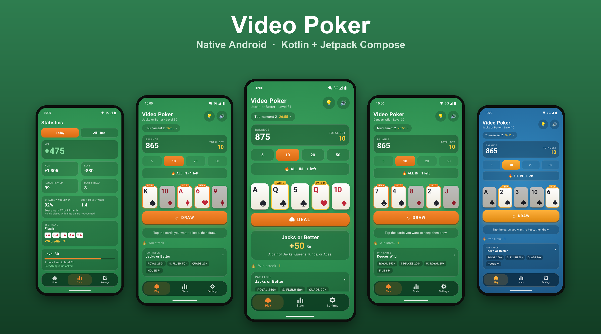
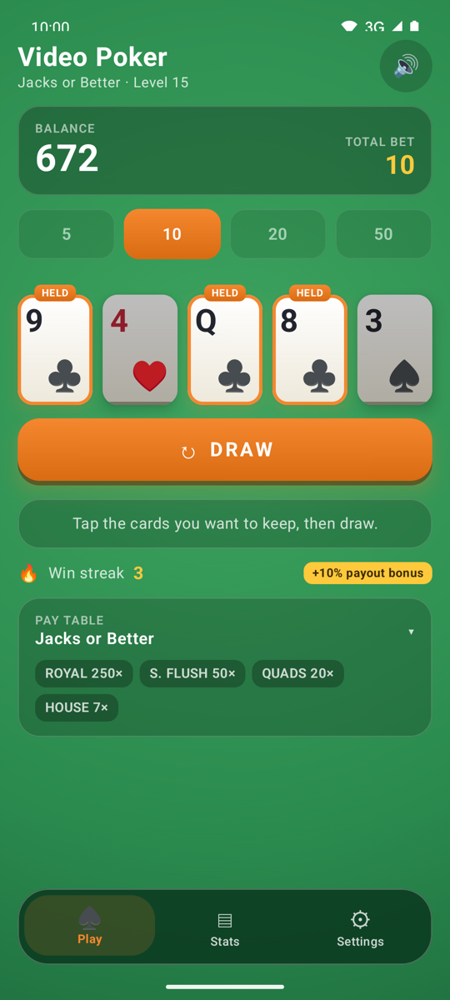
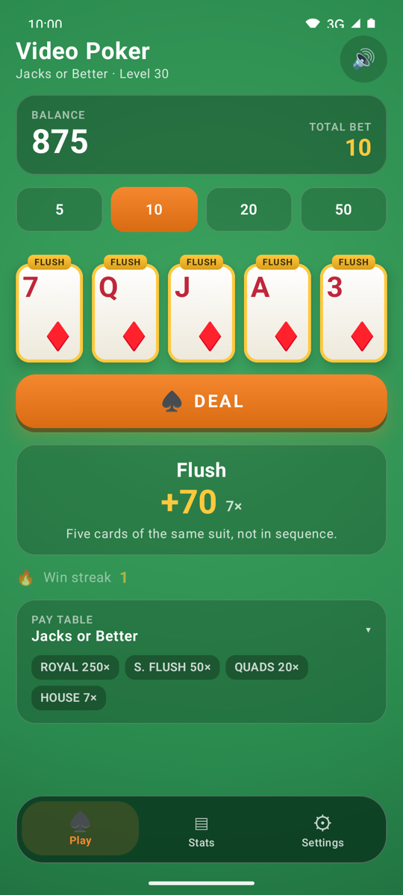
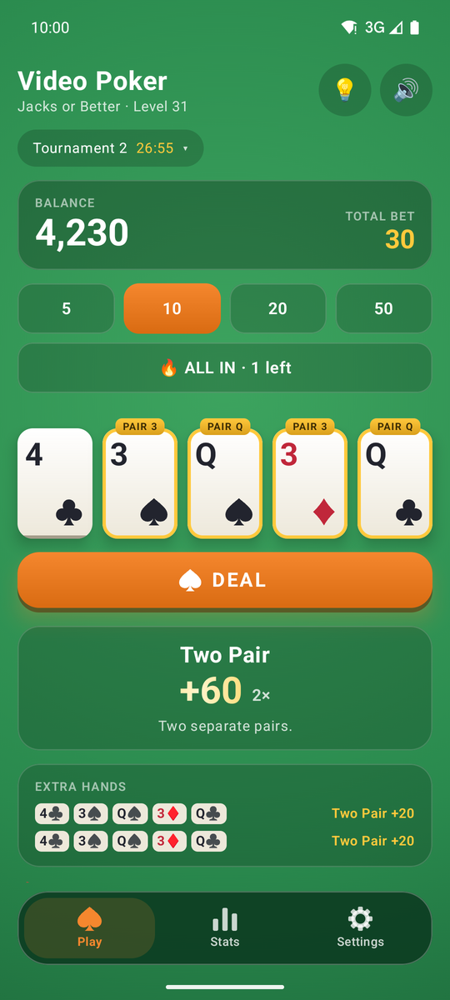
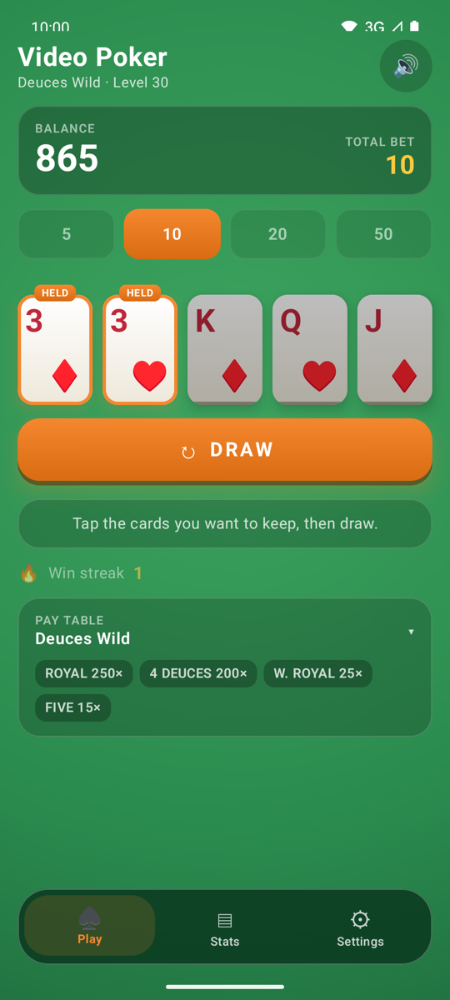
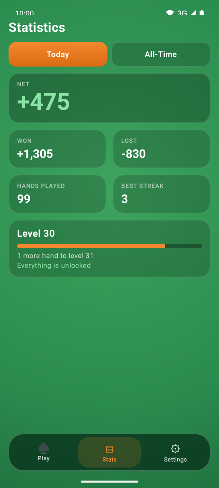
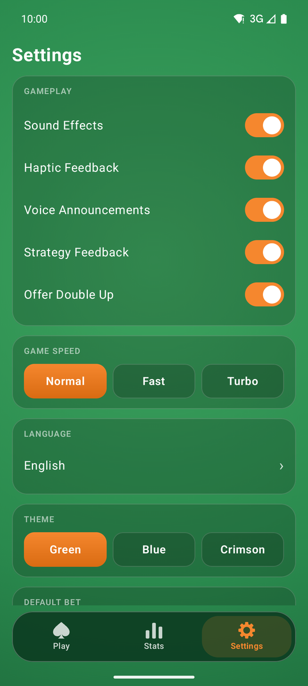
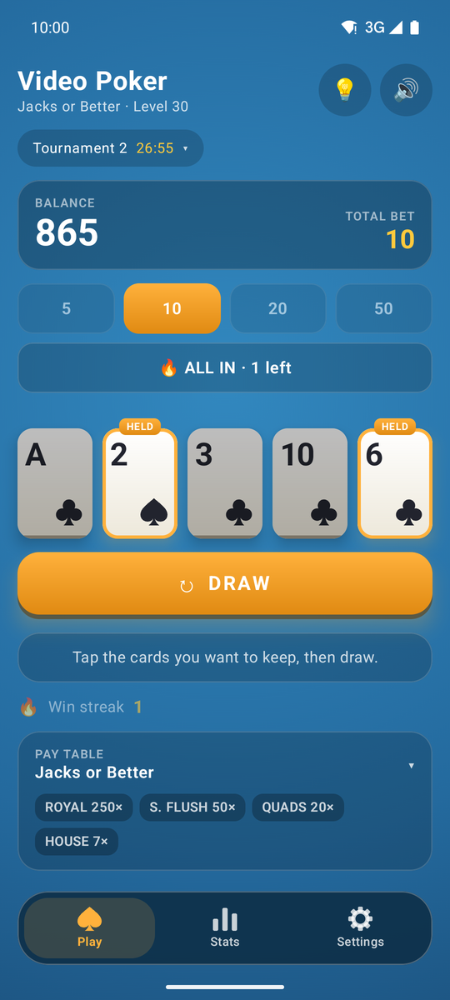
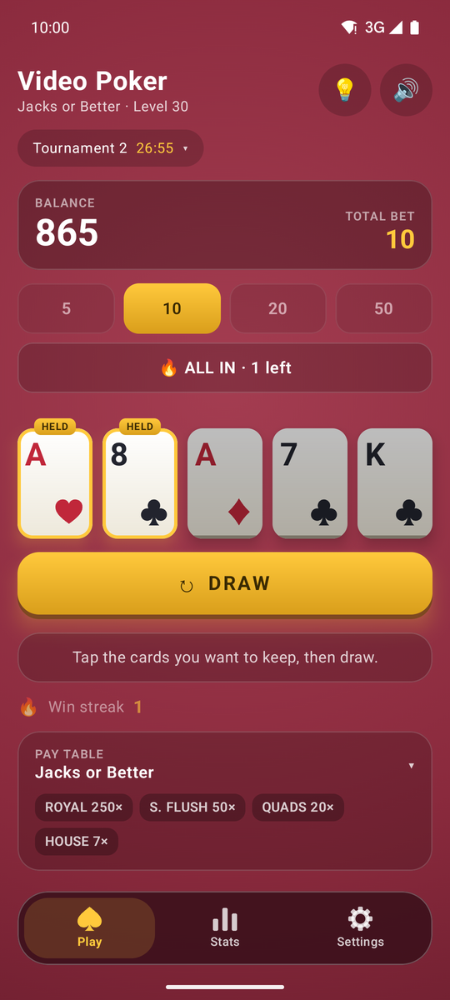

# Video Poker — native Android (Kotlin + Jetpack Compose)

A from-scratch native port of the web game in the repo root. Since 3.0.0 (versionCode 15) it
ships as the update to the Capacitor app's Play listing, under the same applicationId
`com.micorlov.videopoker`, signed with that listing's upload key (`~/keys/videopoker-upload.env`).
The Kotlin namespace stays `com.micorlov.videopoker.nativeapp` (`native` is a reserved word in
Java, so it can't be a package segment).

Release: `source ~/keys/videopoker-upload.env && ./gradlew bundleRelease`, then
`PLAY_TRACK=internal node ../scripts/play-native-release.js validate|commit` (AAB, store text and
every locale's screenshots in one edit) and promote the internal release to production in the
Play Console.



| Hold | Win | Triple Play | Deuces Wild |
|---|---|---|---|
|  |  |  |  |

| Stats | Settings | Blue theme | Crimson theme |
|---|---|---|---|
|  |  |  |  |

_Captured on an Android 16 emulator from real play (hands were dealt by the game, not staged)._

## What is ported

| Area | Status |
|---|---|
| Jacks or Better, Deuces Wild, Bonus Poker, Double Bonus (pay tables, evaluators, unlock levels) | ✅ |
| Deal / hold / draw, bet 5·10·20·50, free rebuy, bet shrink on a small stack | ✅ |
| Triple / Five Play (unlocks at level 10) | ✅ |
| Win-streak bonus, loss escalator, hidden "engagement tuning" boost (`js/game.js`) | ✅ ported as-is |
| Levels (1 per 5 hands), Stats screen (Today / All-Time), reset | ✅ |
| Local save (a hand in progress never costs chips), 3 themes, sound + haptics toggles | ✅ |
| Synthesized sound effects, card-flip animation, win celebrations | ✅ |
| Strategy hints from exact expected values (every hold scored over every draw) | ✅ native only |
| Mistake feedback after each draw, strategy accuracy on the Stats screen | ✅ native only |
| Double up after a win (beat the dealer's card, up to 5 in a row) | ✅ native only |
| Game speed (Normal / Fast / Turbo), tap the cards to deal the next hand | ✅ native only |

**Deferred to later phases:** every social/online feature (Firebase auth, friends, rooms, leaderboards, push). To enable them, see [FIREBASE_SETUP.md](FIREBASE_SETUP.md).

## Layout

```
app/src/main/java/com/micorlov/videopoker/nativeapp/
  domain/   pure Kotlin rules — GameEngine, evaluators, Boost, immutable GameState (no Android)
  data/     KeyValueStore + GameRepository (validated load/save), SharedPreferences adapter
  audio/    SoundSynth (PCM math, no audio files) + SoundPlayer (AudioTrack)
  ui/       GameViewModel (no Android types) and the Compose screens: play/ stats/ settings/ nav/
```

## Build, test, install

A JDK 17+ and the Android SDK (platform 36) are required; the toolchain matches `../android`
(AGP 8.13.0, Gradle 8.14.3).

```bash
cd android-native
./gradlew testDebugUnitTest          # 190+ JVM tests, ~40 s
./gradlew assembleDebug              # app/build/outputs/apk/debug/app-debug.apk
./gradlew connectedDebugAndroidTest  # Compose UI tests; needs a device or emulator
adb install -r app/build/outputs/apk/debug/app-debug.apk
```

## How the port is kept honest

`HandEvaluatorGoldenTest` checks the Kotlin evaluator against the **shipping JS evaluator**
(`js/hand-eval.js`): every one of the 2,598,960 five-card hands, for all four variants, must land on
the same hand type, and ~2,600 sampled hands must match the exact highlight indices. The fixture is
generated by running the JS:

```bash
node android-native/tools/gen-golden.js   # rewrites app/src/test/resources/hand_eval_golden.json
```

Re-run it (and the tests) whenever `js/hand-eval.js` changes.

The hint maths uses its own allocation-free classifier (`domain/FastClassifier.kt`), because
`HoldAnalyzer` scores 2,598,960 hands per deal. `FastClassifierTest` checks it against the
evaluator above on every five-card hand, for every variant, and `HoldAnalyzerTest` checks the
expected values against brute force and hand-counted examples.

## Intentional differences from the web app

- The result panel, win badges and balance count-up wait until the card flips finish, so the
  result is never spoiled mid-animation (the web app shows them immediately).
- The multiplier next to a win is the one actually paid (loss escalator included).
- Tapping a table setting mid-hand explains that the hand must finish first, instead of silently
  doing nothing.
- Portrait-locked on phones (tablets and foldables still rotate).
- Strategy hints are the exact best hold for the pay table in force (loss escalator included),
  worked out off the main thread after each deal, not the web app's rule-of-thumb ladder
  (`js/hints.js`). With hints on, the result panel also shows what the best hold and the current
  holds are worth per credit bet.
- After each draw the result panel says whether the holds were the best play and, if not, what
  was and what the choice cost on average. Hands played with hints on are not counted in the
  accuracy shown on the Stats screen. Settings → Strategy Feedback turns it off.
- Double up, game speed and tap-to-deal do not exist in the web app. Quitting mid double-up
  keeps the stake, the same way quitting mid-hand never costs chips.
